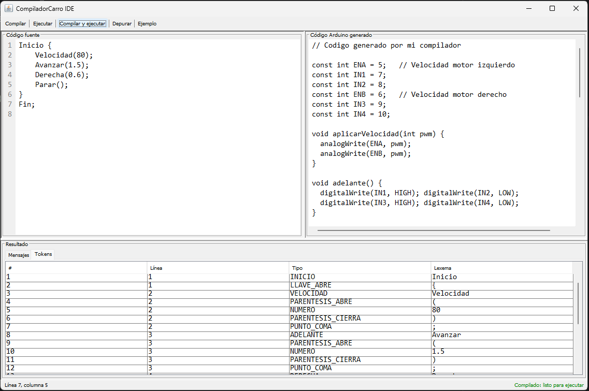

# CompiladorCarro IDE

Compilador desarrollado en **Java** con interfaz gráfica **Swing** para escribir y validar instrucciones de movimiento de un carro, y convertirlas en código compatible con **Arduino**.

## Funcionalidades

- Editor de instrucciones con números de línea.
- **Análisis léxico:** reconocimiento de palabras reservadas, números y símbolos.
- **Análisis sintáctico:** validación de la estructura del programa y de los comandos.
- **Análisis semántico:** comprobación de valores, como velocidad entre 0 y 100 y tiempos mayores que cero.
- **Generación de código Arduino** a partir de las instrucciones válidas.
- Visualización de errores y tabla de tokens para depuración.
- Copia automática del código generado al portapapeles.

## Interfaz gráfica



## Tecnologías

- Java (JDK 17 o superior; el proyecto está configurado en IntelliJ IDEA con JDK 26).
- Java Swing para la interfaz gráfica.
- IntelliJ IDEA como entorno de desarrollo.
- Sin dependencias externas, Maven ni Gradle.

## Cómo ejecutar el proyecto

1. Descarga o clona este repositorio.
2. Abre la carpeta del proyecto en **IntelliJ IDEA**.
3. Configura un **JDK 17 o superior** en el proyecto.
4. Abre `src/Main.java` y ejecuta el método `main`.

## Ejemplo de programa

```text
Inicio {
    Velocidad(80);
    Avanzar(1.5);
    Derecha(0.6);
    Esperar(1);
    Parar();
}
Fin;
```

Las instrucciones disponibles son:

| Instrucción | Descripción |
| --- | --- |
| `Velocidad(n)` | Establece la velocidad entre 0 y 100 (número entero). |
| `Avanzar(t)` | Avanza durante `t` segundos. |
| `Retroceder(t)` | Retrocede durante `t` segundos. |
| `Izquierda(t)` | Gira a la izquierda durante `t` segundos. |
| `Derecha(t)` | Gira a la derecha durante `t` segundos. |
| `Esperar(t)` | Detiene los motores y espera `t` segundos. |
| `Parar()` | Detiene los motores. |

Los tiempos deben ser mayores que cero. El programa debe comenzar con `Inicio {` y terminar con `} Fin;`.

## Cómo utilizar la interfaz

1. Escribe un programa en el editor o pulsa **Ejemplo**.
2. Pulsa **Compilar** para verificar la sintaxis y los valores (**Ctrl+B**).
3. Pulsa **Depurar** para ver los tokens detectados.
4. Pulsa **Ejecutar** para generar el código Arduino de un programa ya compilado, o **Compilar y ejecutar** (**F5**) para realizar ambos pasos.
5. Copia el resultado desde el panel de código generado (también se copia automáticamente al portapapeles) y pégalo en **Arduino IDE**.

> **Nota:** El botón **Ejecutar** genera y copia código Arduino; no carga ni ejecuta el programa directamente en una placa física. Para probarlo en hardware, hay que revisar las conexiones, seleccionar la placa y cargar el código desde Arduino IDE.

## Estructura del proyecto

```text
src/
├── Main.java                  # Inicio de la aplicación
├── Ventana.java               # Interfaz gráfica Swing
├── AnalizadorLexico.java      # Análisis léxico
├── AnalizadorSintactico.java  # Análisis sintáctico
├── AnalizadorSemantico.java   # Análisis semántico
├── GeneradorArduino.java      # Generación del código Arduino
├── Instruccion.java           # Representación de instrucciones
├── Token.java                 # Representación de tokens
└── TipoToken.java             # Tipos de token
```

## Sobre el código Arduino generado

El generador utiliza los pines `ENA=5`, `ENB=6`, `IN1=7`, `IN2=8`, `IN3=9` e `IN4=10` para el control de dos motores. Traduce la velocidad de un porcentaje (0–100) a PWM (0–255), y los tiempos de segundos a milisegundos.

La secuencia se escribe dentro de `setup()` y se ejecuta una sola vez; `loop()` permanece vacío.
